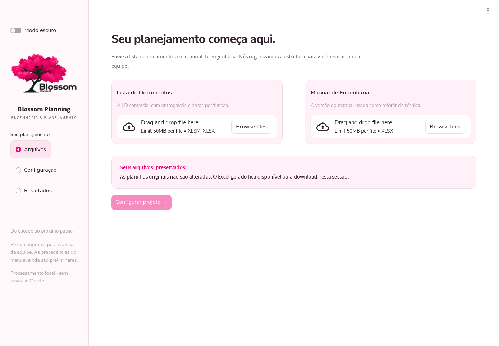

# Blossom Planning — identidade e navegação

Preferências confirmadas pelo usuário: rosa cerejeira, nenhum fundo verde, claro/escuro com início no claro, fundo geral branco, cartões suavemente rosados, fonte arredondada, botões pink uniformes, logo médio no menu lateral e resultados em seções expansíveis.

## Entrega

- Menu lateral com Arquivos, Configuração e Resultados; navegação preserva arquivos enviados e premissas.
- Fundo branco no claro e quase preto no escuro, cartões rosa claro/rosa profundo, bordas discretas, cantos arredondados e microtransições com suporte a movimento reduzido.
- Logos transparentes preparados das referências enviadas, selecionados conforme o tema. As imagens foram tratadas com ferramenta de edição generativa e não são arquivos vetoriais oficiais; podem ser substituídas pelos PNGs originais mantendo os nomes em assets.
- Fonte Nunito Sans e licença SIL OFL incluídas localmente a partir do repositório oficial Google Fonts.
- Resultados com resumo em quatro cartões, download principal e painéis expansíveis para WBS, atividades, pendências, auditoria e relatórios complementares.
- Tabelas com paginação de 100 registros, cores compatíveis com o tema e indentação da hierarquia. Conteúdo de arquivos exibido nas tabelas é escapado como texto.
- Mudanças de arquivos ou premissas removem o resultado anterior; alternar tema/navegar não remove resultados. Não há persistência após encerrar a sessão.

## Validação

24 testes automatizados passaram, incluindo navegação, retenção de parâmetros, troca de tema e apresentação dos resultados reais. Testes anteriores de cálculo, hierarquia, integridade e reprodutibilidade preservados.

Fluxo completo também executado no Chromium: upload da LD original e do manual, configuração, retorno a Arquivos, restauração do nome do projeto, geração, download do Excel e tema escuro. Confirmados 952 atividades e os totais originais. Verificados fonte Nunito Sans carregada, cartões RGB 255/241/247 e ausência de rolagem horizontal da página em viewport de 390 px. `pip check` sem inconsistências.

Motor, percentuais, HH e regras de engenharia não foram alterados. A interpretação completa das precedências do manual continua pendente. Não houve hospedagem pública ou adição de login. O iniciador Windows permanece preparado, sem execução em Windows neste ambiente Linux.

## Prévia das telas

Tema claro, seção Arquivos:

Tema escuro, seção Configuração:

